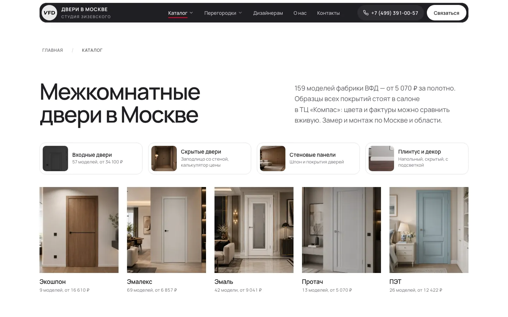
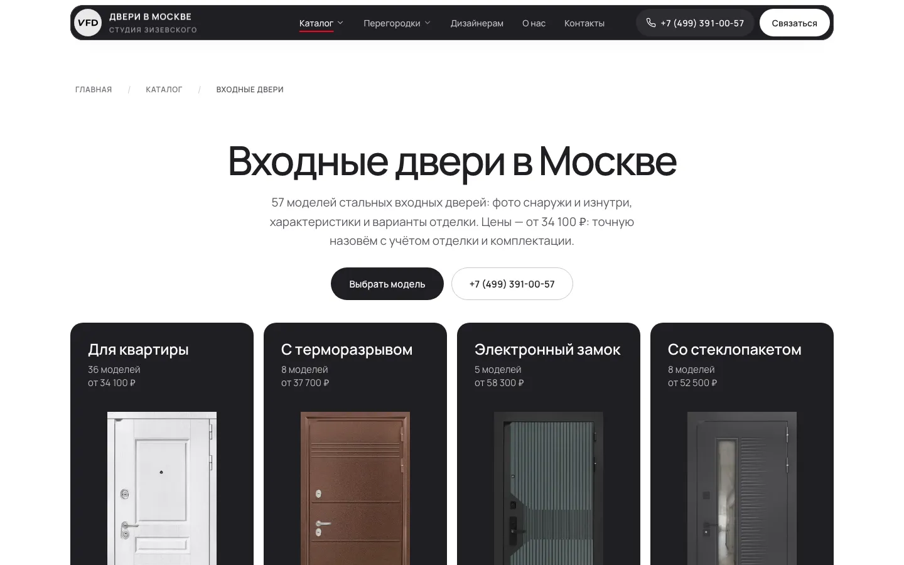
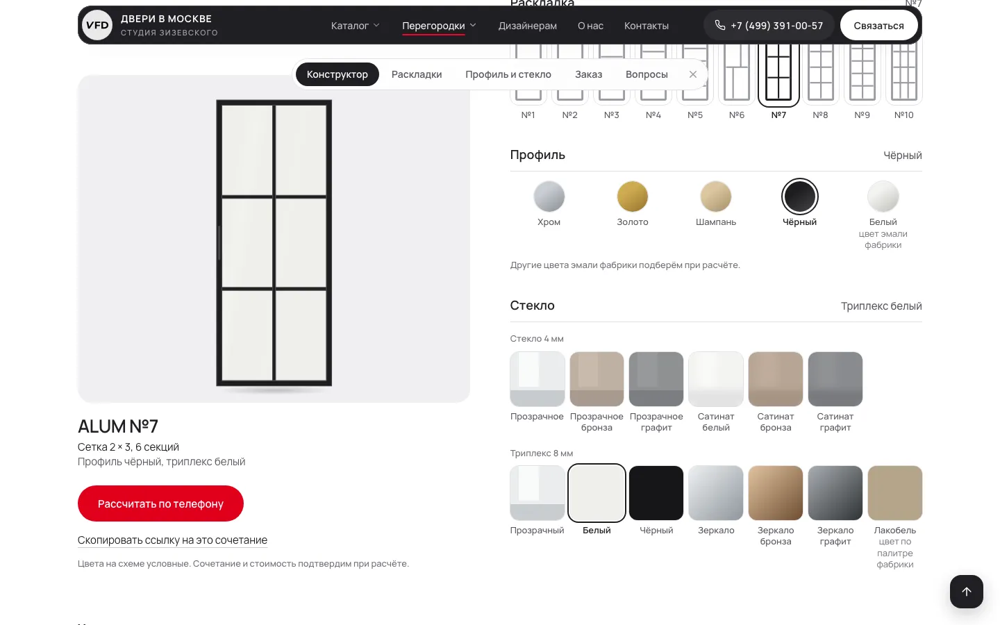
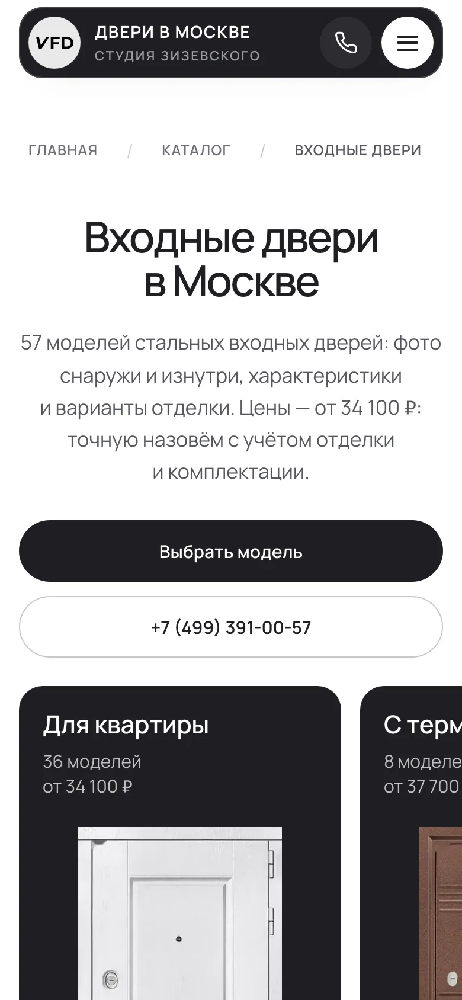

# Студия Зизевского — сайт салона дверей в Москве

**Живой сайт: [dveriziz.ru](https://dveriziz.ru)** · боевой проект для реального бизнеса: салон дверей и перегородок в ТЦ «Компас» (Москва).

Один разработчик, ~4 недели, от пустого репозитория до работающего магазина-витрины с каталогом, CMS, SEO-инфраструктурой и собственным сервером. Ниже — что внутри и чем это интересно инженерно.

> *English in short:* a production site for a Moscow door showroom — Astro 7 + Vue 3 islands + Tailwind 4, a Supabase-backed catalog, a Strapi 5 headless CMS with publish-time content validation, and a hand-rolled SEO/deploy pipeline (IndexNow, JSON-LD, image sitemap, idempotent nginx provisioning). Fully static output (470 pages), 168 tests, no application server in production. Docs are in Russian.

| Каталог | Входные двери |
|---|---|
|  |  |
| **Конструктор перегородок** | **Телефон** |
|  |  |

## Что это за проект

Заказчику нужны клиенты из поиска и карточка салона, а не просто «красивые страницы». Поэтому сайт сделан как инструмент:

- **Каталог** межкомнатных дверей с ценами из Supabase: фильтры, сортировка и состояние в URL — всё на клиенте, без запросов к серверу.
- **Входные двери** — 57 моделей, страницы с вариантами отделки, подбор «за минуту», интерактивная схема двери.
- **Скрытые двери** с калькулятором цены, **конструктор алюминиевых перегородок** (раскладка × профиль × стекло → живой SVG), стеновые панели, декор, плинтусы.
- **Статьи, акции, портфолио, отзывы** — материалы ведёт директор в Strapi.
- **Сквозное SEO**: посадочные страницы по спросу, микроразметка, карта сайта с фото, IndexNow, `llms.txt`.

## Чем это интересно инженерно

**1. Статика с «островами».** 470 страниц собираются Astro в обычные файлы; интерактивность — отдельные Vue-острова с продуманными стратегиями загрузки (`client:only`, `load`, `visible`). Для робота подвал отдаётся серверным HTML, чтобы сквозная перелинковка была в исходнике, а не в JavaScript.

**2. Три источника данных, ни один не молчит.** Каталог — Supabase, редакционный контент — Strapi, продуктовые линейки — типизированные TS-модули. Сборка **падает** на любой ошибке данных: пустой каталог, исчезнувшая серия, неизвестная подстановка, опасная ссылка. Пустой раздел на сайт не уходит никогда.

**3. CMS как код и проверка перед публикацией.** Типы контента, русские подписи полей и права редактора описаны в коде Strapi. Кнопка «Опубликовать» запускает те же проверки, что и сборка (длина лида, заголовки, описания фото, уникальность title, SEO-правила), прямо внутри транзакции публикации. Директор не может опубликовать статью, которая сломает сайт.

**4. Данные не копируются руками.** Адрес, цены, размеры и сроки живут в одном месте, а в статьях это подстановки `{цена комплекта Секрет}`. Поменялась цена — обновились все тексты. Тесты сверяют таблицу подстановок, код и инструкцию директора.

**5. SEO-инженерия.** Семантическое ядро из подсказок поиска (скрипт и данные в `docs/seo/`), генератор заголовков с подгонкой под длину (`fitPhrase`), уникальные title у ~320 страниц моделей (тест), `Product`/`FAQPage`/`HowTo`/`BlogPosting` JSON-LD из одной функции, карта сайта с `lastmod` по **хешу содержимого страницы**, а не по времени сборки, пинг IndexNow только по реально изменившимся страницам.

**6. Предметная логика под тестами.** Цены скрытых дверей — чистые функции: тесты фиксируют каждое число прайса. Конструктор перегородок генерирует створку как SVG по геометрии раскладки. Фильтры каталога, подбор входной двери и подстановки — тоже чистые функции.

**7. Конвейер изображений.** Генераторы `sharp` делают адаптивные копии с хешем в имени (кэш не залипает). Фото каталога зеркалируются в репозиторий. Водяные знаки партнёра на фото входных дверей убраны нейросетью LaMa (ONNX Runtime, скрипт — `assets/entrance-doors/tools/`).

**8. Инфраструктура как код.** Идемпотентный скрипт настройки VPS (nginx, файрвол, fail2ban, HTTPS), конфиги nginx в репозитории, деплой одной командой с проверками до выкладки (каждый URL карты сайта существует, `robots.txt` боевой, нет заглушек).

**9. Конфиденциальность по умолчанию.** Яндекс Метрика грузится только после согласия на cookie, отказ — равноправная кнопка; документы согласия и политики собираются из одного модуля данных.

## Стек

Astro 7 · Vue 3 · TypeScript · Tailwind CSS v4 · Strapi 5 (SQLite) · Supabase (PostgreSQL) · sharp · nginx · Node.js · `node:test` (+`tsx`)

В цифрах: ~45 тыс. строк кода (Astro, Vue, TS, скрипты), 89 компонентов, 168 тестов, 470 страниц на выходе, 255 коммитов.

## Безопасность

Сайт статический: на сервере нет приложения, базы и админки. Секреты не хранятся в репозитории (история проверена), CMS слушает только localhost, контент из CMS экранируется, на сервере CSP и заголовки безопасности. Подробно — в [SECURITY.md](SECURITY.md), включая то, что требует внимания.

## Запуск и документация

```bash
npm install && npm run cms:install
cp .env.example .env && cp cms/.env.example cms/.env   # заполнить значения
npm run cms     # Strapi: http://localhost:1337/admin
npm run dev     # сайт:   http://localhost:4321
npm test        # 168 тестов
```

- [Руководство разработчика](docs/DEVELOPMENT.md) — окружение, структура репозитория, Strapi, изображения, SEO, деплой.
- [CLAUDE.md](CLAUDE.md) — архитектурные правила и решения (в проекте использовался ИИ-ассистент; правила записаны, чтобы код оставался единообразным).
- [Инструкция директору](docs/director-guide.md) — как вести статьи, акции и портфолио.

## Права

Код опубликован для ознакомления как работа автора. Тексты, фотографии, торговые марки и данные салона и его партнёров принадлежат их владельцам и не лицензируются для повторного использования.
