<div align="center">

# Студия Зизевского — сайт салона дверей в Москве

**Действующий сайт реального бизнеса: [dveriziz.ru](https://dveriziz.ru)**

Каталог и калькуляторы · собственная дизайн-система · headless CMS · SEO-конвейер · Lighthouse 98–100


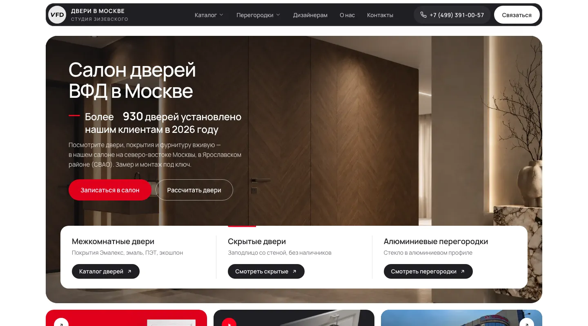

</div>

> **In short (EN).** A production website for a Moscow door showroom, built end-to-end by one developer in ~4 weeks: a custom design system on Astro 7 + Vue 3 islands + Tailwind 4, a Supabase-backed catalog with client-side filtering, live price calculators and an SVG configurator, a Strapi 5 CMS with publish-time content validation, and a hand-rolled SEO/deploy pipeline (JSON-LD, content-hash `lastmod`, IndexNow, idempotent nginx provisioning). 470 static pages, 168 tests, **Lighthouse mobile 98–100 on every category, measured on production**. Docs are in Russian.

## Содержание

[Задача и результат](#задача-и-результат) · [Бизнес-задачи → решения](#бизнес-задачи--решения) · [Дизайн-система](#дизайн-система) · [UX/UI](#uxui) · [Производительность](#производительность) · [Архитектура](#архитектура) · [Инженерные решения](#инженерные-решения) · [Безопасность](#безопасность) · [Запуск](#запуск-и-документация)

## Задача и результат

Салон открыл сайт без трафика: за первые 11 дней в Метрике было около 160 визитов, 113 из них — на главную, глубже почти никто не заходил. Заказчику нужны были **клиенты из поиска и звонки**, а не «красивые страницы». Поэтому сайт сделан как инструмент продаж:

- человек находит салон по запросам («скрытые двери в Москве», «стеновые панели на заказ»), видит **цену сразу** и собирает свой вариант в калькуляторе;
- в один тап пишет менеджеру в Telegram, MAX или WhatsApp — **с готовым сообщением** о выбранной модели;
- директор сам ведёт статьи, акции и портфолио в CMS и не может опубликовать то, что сломает сайт;
- всё это работает на дешёвом VPS без серверного приложения.

| | |
|---|---|
| **470** страниц, собранных в статику | **168** автотестов на данные, цены и SEO-правила |
| **98–100** Lighthouse Performance (mobile, опубликованный сайт) | **100 / 100 / 100** Accessibility · Best Practices · SEO |
| **0** ms блокировки, **0** CLS | **~45 тыс.** строк кода, 89 компонентов, 23 генератора |

## Бизнес-задачи → решения

| Задача бизнеса | Что сделано | Где в коде |
|---|---|---|
| **Привлечь трафик из поиска** | Семантическое ядро из подсказок поиска → страница под каждый кластер запросов; уникальные `title` у 318 страниц моделей; подвал отдаётся серверным HTML — сквозная перелинковка видна роботу без JS; `llms.txt`, карта сайта с фото | [`docs/seo/`](docs/seo/semantic-core.md), `src/lib/seo-title.ts`, `src/lib/product-text.ts` |
| **Показать цену, а не «звоните»** | Каталог на 159 моделей с ценами из Supabase; **калькулятор скрытых дверей** — полотно, кромка, короб, высота → итог пересчитывается мгновенно | `src/lib/hidden-door-price.ts` (тесты фиксируют каждое число прайса) |
| **Снять страх «не впишется в интерьер»** | **Конструктор перегородок**: раскладка × профиль × стекло → живая схема створки, сочетание сохраняется в ссылке | `src/components/partitions/AlumBuilder.astro` |
| **Довести до обращения** | Кнопки мессенджеров с предзаполненным сообщением про выбранную модель; «Построить маршрут» ведёт в карточку салона на Яндекс Картах; три канала связи равноправны | `src/lib/messengers.ts`, `src/lib/map-links.ts` |
| **Вызвать доверие** | Отзывы подтягиваются из карточки на Яндекс Картах, `aggregateRating` в микроразметке, реальные объекты в портфолио, «от» вместо выдуманных точных цен | `src/data/reviews.ts`, `src/lib/local-business-schema.ts` |
| **Чтобы директор вёл сайт сам** | Strapi 5 на русском: статьи, акции, портфолио; перед «Опубликовать» — те же проверки, что и в сборке; в тексте вместо цифр — подстановки `{цена комплекта Секрет}` | `cms/`, `src/lib/content-checks.ts`, [инструкция](docs/director-guide.md) |
| **Соответствовать закону** | Метрика грузится только после согласия на cookie (ФЗ-152), «Отказаться» — равноправная кнопка, документы согласия собираются из одного модуля данных | `src/components/analytics/`, `src/data/personal-data.ts` |
| **Дёшево и надёжно жить** | Статика на nginx: нет приложения и базы, которые можно взломать или «положить» нагрузкой; выкладка одной командой с проверками до загрузки | `scripts/deploy-site.mjs`, `deploy/` |

<table>
<tr>
<td width="50%">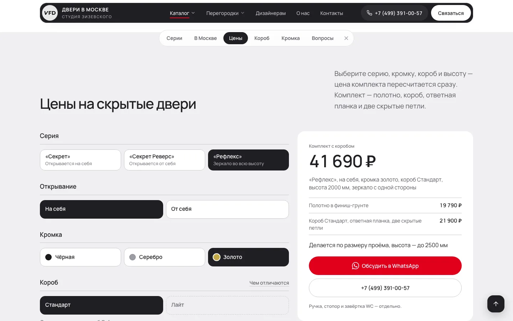<br><sub><b>Калькулятор скрытых дверей</b> — выбор серии, кромки, короба и высоты, итог и кнопки связи рядом</sub></td>
<td width="50%">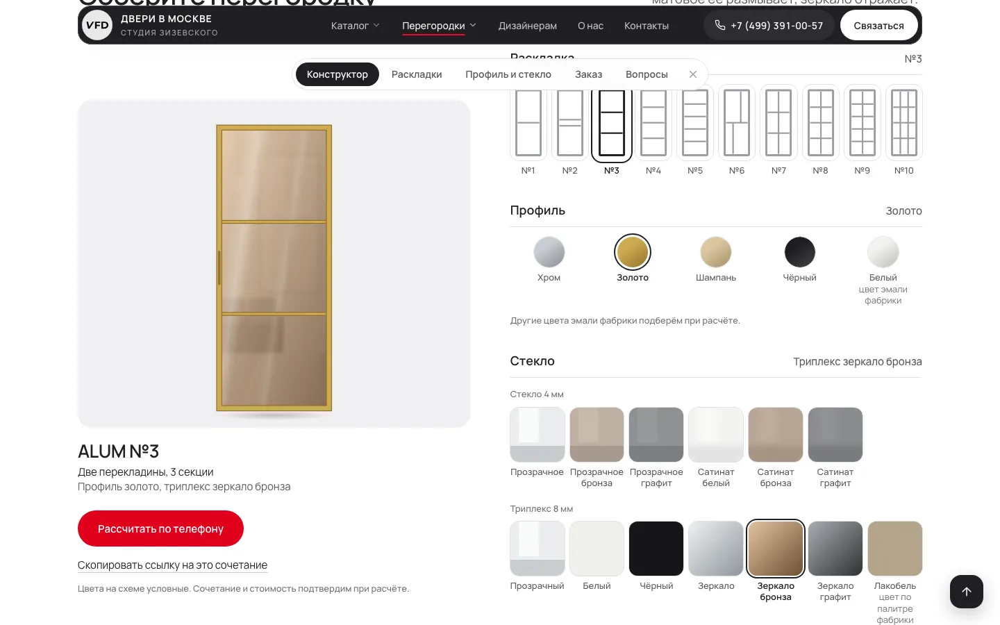<br><sub><b>Конструктор перегородок</b> — 10 раскладок × 5 профилей × 13 стёкол, схема перерисовывается на лету</sub></td>
</tr>
<tr>
<td>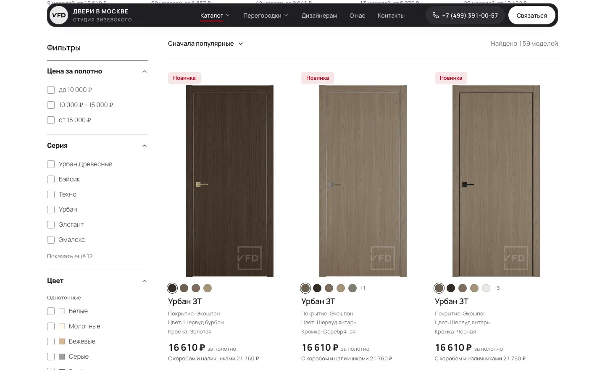<br><sub><b>Каталог</b> — фильтры, сортировка и состояние в URL; всё на клиенте, без запросов к серверу</sub></td>
<td>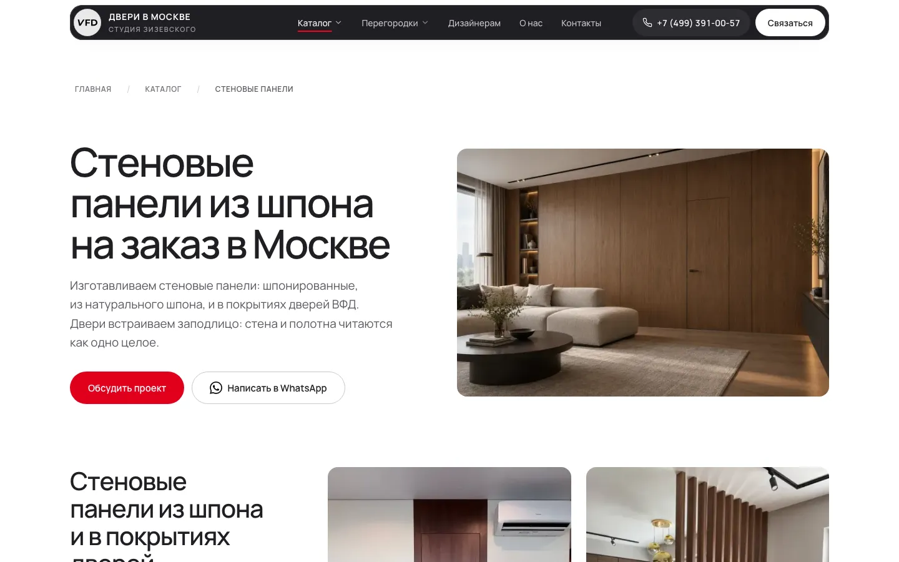<br><sub><b>Посадочная страница</b> — под запрос «стеновые панели на заказ»: материал → помещение → двери в панелях → цена → вопросы</sub></td>
</tr>
</table>

## Дизайн-система

Своя система «Экспозиция» — не набор готовых компонентов, а набор **принципов, токенов и правил**, которые проверяются в ревью и частично тестами. Описана в шапке [`src/styles/home.css`](src/styles/home.css).

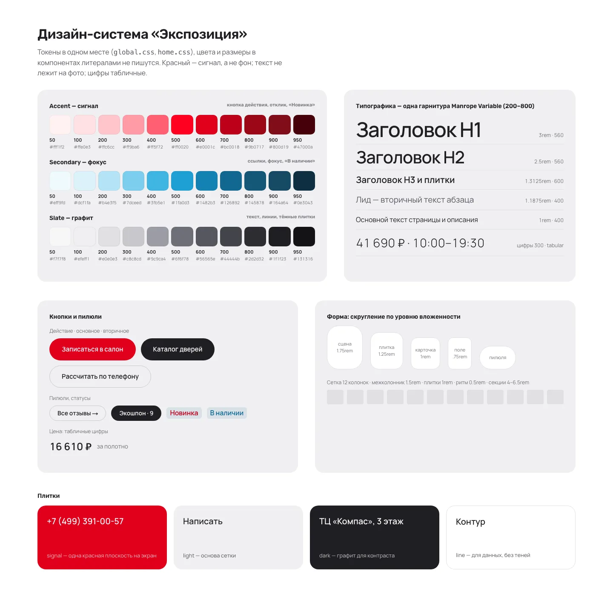

<sub>Эта доска собрана из **настоящих** стилей сайта, не нарисована отдельно.</sub>

**Принципы**

1. **Товар — главное изображение.** Реальные модели и интерьеры, без абстрактных картинок «для настроения».
2. **Текст не лежит на фото** — подпись под изображением, как табличка у образца в зале. Исключение — первый экран, там затемнение только под текстом.
3. **Красный — сигнал, а не фон.** Главное действие экрана и отклик на наведение; не больше одной красной плоскости на экран.
4. **Линейки — только для данных.** Волосяная линия делит адрес и часы, шаги и строки списков; рамок и теней у блоков нет.
5. **Цифры табличные** (`tabular-nums`): цены и часы не «прыгают» в колонках.

**Токены и правила**

- **Цвет** — три шкалы по 11 ступеней (accent, secondary, slate) + семантические токены (`ink`, `body`, `link`, `graphite`…). Литералы `#hex` в компонентах запрещены.
- **Контраст считается, а не «на глаз».** Красная заливка под белым текстом — на ступень плотнее (`#e0001c`, контраст 5,0 при норме AA 4,5); приглушённый текст на сером фоне — отдельный токен (4,8 вместо 4,3). Это записано рядом с токеном и объясняет, *почему* так.
- **Типографика** — одна вариативная гарнитура Manrope (200–800): иерархия строится размером, весом (560 для заголовков) и трекингом, не сменой шрифтов. Шкала `text-step-0…7` с `clamp()` живёт в токенах, а не в разметке.
- **Форма** — скругление по уровню вложенности: сцена 1,75 rem → плитка 1,25 → карточка 1 → поле 0,75 → пилюля.
- **Сетка и ритм** — 12 колонок, шаг 0,5 rem; все размеры в `rem`, вёрстка масштабируется вместе с системным шрифтом.
- **Компоненты** с едиными состояниями: `.h-btn` (signal / ink / quiet), `.h-pill`, `.h-tile` (signal / light / dark), `.h-status`, `.h-chip`, `.h-card`, `.h-faq`.

<table>
<tr>
<td width="50%">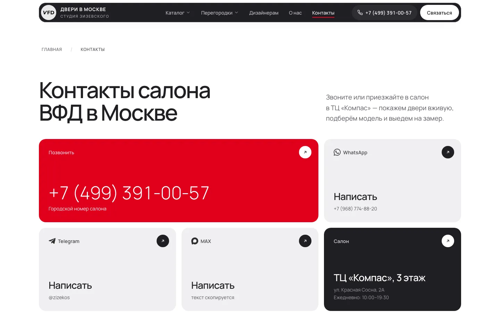<br><sub>Плитки одной системы: сигнальная (звонок), светлые (мессенджеры), графитовая (салон)</sub></td>
<td width="50%">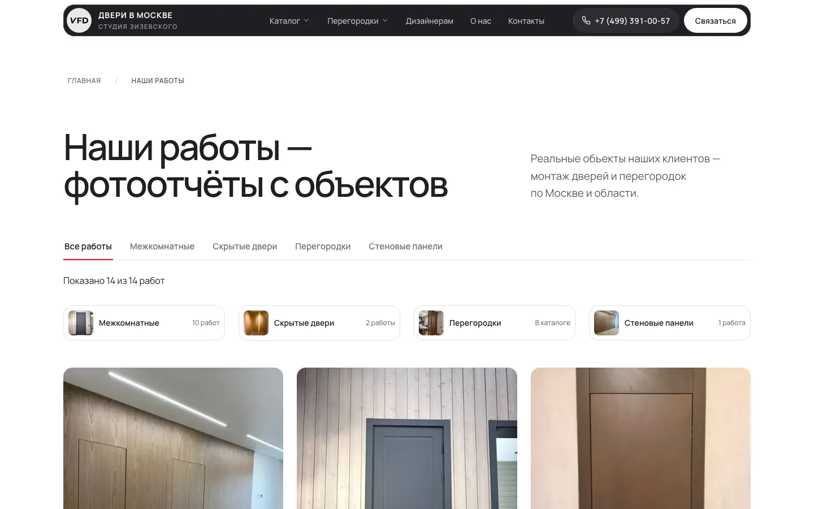<br><sub>Портфолио: категории-чипы, сетка фото, данные из CMS</sub></td>
</tr>
</table>

## UX/UI

- **Mobile-first, а не «адаптив потом».** Каждая страница проверяется на 390 и 320 px: ленты с «выглядывающей» следующей карточкой и snap-прокруткой, кнопки на всю ширину, фильтры — листом снизу, шапка с телефоном в один тап.
- **Состояние в URL.** Фильтры каталога и сочетание в конструкторе кодируются в адресе: выбор можно отправить ссылкой («Скопировать ссылку на это сочетание»), он переживает перезагрузку и кнопку «назад».
- **Сначала содержимое, потом скрипт.** Страницы читаются и без JavaScript; калькуляторы и фильтры — прогрессивное улучшение.
- **Доступность по умолчанию.** Lighthouse Accessibility 100 на всех проверенных страницах; видимый фокус, `aria-live` для результатов, `prefers-reduced-motion` отключает анимацию, чекбоксы и радио — настоящие `<input>`, а не «div-кнопки».
- **Честные формулировки.** Цены «от», когда итог зависит от отделки; «Другие цвета подберём при расчёте» там, где схема условна. Меньше обещаний — меньше недоверия.
- **Минимум отвлекающего.** Один красный акцент на экран, без поп-апов на входе; баннер cookie — единственное окно, и оно не блокирует чтение.

<table>
<tr>
<td align="center" width="25%">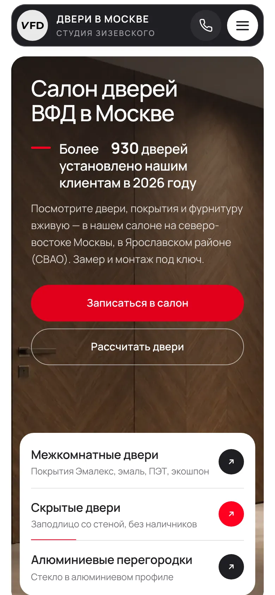<br><sub>Главная</sub></td>
<td align="center" width="25%">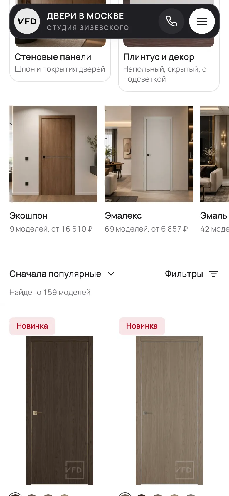<br><sub>Каталог: ленты покрытий</sub></td>
<td align="center" width="25%">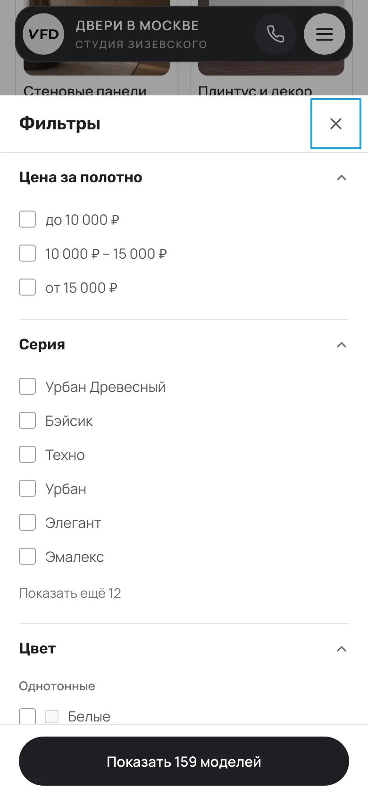<br><sub>Фильтры — лист снизу</sub></td>
<td align="center" width="25%"><br><sub>Перегородки</sub></td>
</tr>
</table>

## Производительность

Замер — **Lighthouse 13 на опубликованном сайте dveriziz.ru, мобильный профиль по умолчанию** (эмуляция телефона, медленный 4G, замедленный CPU), 31.10.2026:

| Страница | Performance | A11y | Best Practices | SEO | LCP | TBT | CLS | Вес |
|---|:-:|:-:|:-:|:-:|:-:|:-:|:-:|:-:|
| Главная | **98** | 100 | 100 | 100 | 2,1 s | 0 ms | 0 | 978 KiB |
| Каталог | **99** | 100 | 100 | 100 | 1,5 s | 10 ms | 0 | 1,5 MiB |
| Страница-подборка | **100** | 100 | 100 | 100 | 1,1 s | 0 ms | 0 | 1,2 MiB |
| Конструктор перегородок | **99** | 100 | 100 | 100 | 1,7 s | 0 ms | 0 | 331 KiB |

Почему так быстро:

- **Статика вместо рендеринга на запрос.** HTML готов на этапе сборки, nginx отдаёт файлы; нет серверного времени ответа и «холодных стартов».
- **Острова гидрации.** JavaScript нужен только интерактивным блокам и грузится по необходимости (`client:visible`, `client:idle`); на странице ~77–89 KiB скриптов (по сети, со сжатием), большая часть — общий рантайм Vue.
- **Шрифты без скачков.** Вариативный Manrope self-hosted, `woff2` с `unicode-range`, preload критичных начертаний и **метрически подогнанный fallback** (`size-adjust`, `ascent-override`) — текст не «прыгает» при подмене шрифта, CLS = 0.
- **Критический CSS внутри страницы** (`inlineStylesheets: 'always'`), без блокирующих запросов стилей.
- **LCP-картинка с `fetchpriority="high"` и preload**, остальные — `loading="lazy"`; у всех изображений заданы размеры.
- **Конвейер изображений.** 23 генератора на `sharp` делают адаптивные копии (`srcset`) с хешем в имени: кэш не залипает, а старые адреса не ломаются. В репозитории ~980 оптимизированных рендеров и ~670 зеркалированных фото каталога.
- **Фильтрация на клиенте** чистыми функциями над готовым массивом — без запросов на каждый клик.
- **Нулевая «налоговая» сторонних скриптов.** Единственный внешний сервис — Яндекс Метрика, и она загружается только после согласия.

## Архитектура

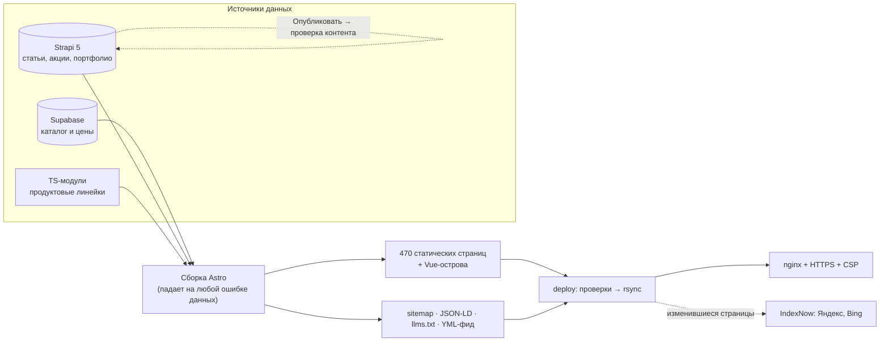

## Инженерные решения

**Три источника данных, ни один не молчит.** Каталог — Supabase, редакционный контент — Strapi, продуктовые линейки — типизированные TS-модули. Сборка **падает** на пустой каталог, исчезнувшую серию, неизвестную подстановку или опасную ссылку: пустой раздел на сайт не уходит никогда.

**CMS как код.** Типы контента, русские подписи, права редактора и проверки публикации описаны в коде Strapi. Кнопка «Опубликовать» запускает ту же функцию проверки, что и сборка (длина лида, заголовки, описания фото, уникальность `title`), прямо внутри транзакции публикации.

**Данные не копируются руками.** Цена, размер, срок и адрес живут в одном месте; в статьях — подстановки, которые сверяют тесты (таблица имён, значения, инструкция директора). Поменялась цена — обновились все тексты.

**SEO как инженерная задача.** Генератор заголовков с подгонкой под длину (`fitPhrase`), микроразметка `Product`/`FAQPage`/`HowTo`/`BlogPosting` из одной функции, фид для Яндекс Товаров из того же источника, что и страницы (цена и фото не расходятся), `lastmod` по **хешу содержимого страницы**, а не по времени сборки, и пинг IndexNow только по реально изменившимся страницам.

**Предметная логика под тестами.** Цены, фильтры каталога, подстановки и подбор — чистые функции без DOM; 168 тестов на `node:test`.

**Инфраструктура как код.** Идемпотентный скрипт настройки VPS (nginx, файрвол, fail2ban, HTTPS), конфиги и CSP в репозитории, деплой с проверками до выкладки: каждый URL карты сайта существует, `robots.txt` без запрета индексации, заглушек нет.

## Безопасность

Статический сайт: на сервере нет приложения, базы и админки. Репозиторий и вся его история проверены на секреты, зависимости — `npm audit`: 0 уязвимостей, CMS слушает только localhost, контент из CMS экранируется, на сервере CSP и заголовки безопасности. Подробно — в [SECURITY.md](SECURITY.md), включая то, что требует внимания.

## Запуск и документация

```bash
npm install && npm run cms:install
cp .env.example .env && cp cms/.env.example cms/.env   # заполнить значения
npm run cms     # Strapi: http://localhost:1337/admin
npm run dev     # сайт:   http://localhost:4321
npm test        # 168 тестов
```

- [Руководство разработчика](docs/DEVELOPMENT.md) — окружение, структура репозитория, Strapi, изображения, SEO, деплой.
- [CLAUDE.md](CLAUDE.md) — архитектурные правила и решения (в проекте использовался ИИ-ассистент; правила записаны, чтобы код оставался единообразным).
- [Инструкция директору](docs/director-guide.md) — как вести статьи, акции и портфолио.

## Права

Код опубликован для ознакомления как работа автора. Тексты, фотографии, торговые марки и данные салона и его партнёров принадлежат их владельцам и не лицензируются для повторного использования.
