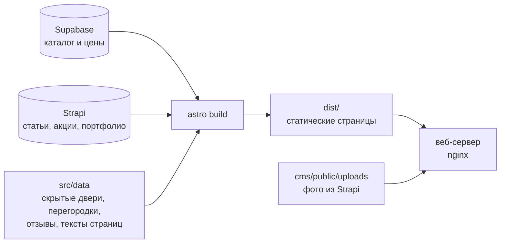

# Студия Зизевского — сайт салона дверей ВФД в Москве

Сайт салона **Владимирской фабрики дверей** в ТЦ «Компас» (Москва, ул. Красная Сосна, 2А, 3 этаж): каталог межкомнатных и скрытых дверей с ценами, алюминиевые перегородки с конструктором, статьи, акции, портфолио и отзывы клиентов. Каталог и цены — в Supabase, материалы, которые ведёт директор салона, — в CMS Strapi. Сайт собирается в статические файлы и не требует сервера приложений для показа страниц.

Проект вырос из кодовой базы сайта салона ВФД в Челябинске: архитектура общая, бренд, контент и дизайн — свои.

> **Состояние на 16.10.2026.** Сайт готов к показу заказчику, демо — https://vfd-moscow-compas.vercel.app (закрыто от поисковиков). Домен — `dveriziz.ru`. Для запуска нужны сервер в России со Strapi и несколько данных от владельца — см. [«Перед запуском»](#перед-запуском).

## Содержание

- [Быстрый старт](#быстрый-старт)
- [Переменные окружения](#переменные-окружения)
- [Как устроен сайт](#как-устроен-сайт)
- [Структура репозитория](#структура-репозитория)
- [Кто и где меняет контент](#кто-и-где-меняет-контент)
- [Strapi](#strapi)
- [Изображения](#изображения)
- [SEO](#seo)
- [Команды](#команды)
- [Проверки качества](#проверки-качества)
- [Деплой](#деплой)
- [Перед запуском](#перед-запуском)
- [Передача проекта](#передача-проекта)
- [Документация](#документация)

## Быстрый старт

Нужны Node.js **22.12+** (Strapi поддерживает Node 20–26, удобнее всего Node 22 или 24 LTS), npm и ключи Supabase-проекта каталога.

```bash
npm install
cp .env.example .env            # заполнить PUBLIC_SUPABASE_URL и PUBLIC_SUPABASE_ANON_KEY
cp cms/.env.example cms/.env    # заполнить секреты Strapi (см. ниже)
npm run cms:install             # зависимости Strapi, первый раз и после обновления

npm run cms                     # терминал 1: Strapi, админка — http://localhost:1337/admin
npm run dev                     # терминал 2: сайт — http://localhost:4321
```

При первом запуске Strapi сам создаёт ключ «site-build» только для чтения и дописывает `STRAPI_URL` и `STRAPI_TOKEN` в `.env` сайта. Пока Strapi не запущен, сайт не соберётся: пустой раздел на сайт не уходит, сборка останавливается с подсказкой.

## Переменные окружения

Файлы `.env` в Git не попадают. Образцы — `.env.example` и `cms/.env.example`.

**Сайт — `.env`**

| Переменная | Назначение |
|---|---|
| `PUBLIC_SUPABASE_URL`, `PUBLIC_SUPABASE_ANON_KEY` | каталог и цены (Supabase, ключ только для чтения) |
| `STRAPI_URL`, `STRAPI_TOKEN` | адрес Strapi и ключ только для чтения. В разработке пишутся сами; на сервере ключ создаётся в админке: «Настройки → API-токены», тип «Только для чтения» |

**Strapi — `cms/.env`**

| Переменная | Назначение |
|---|---|
| `HOST`, `PORT` | где слушает Strapi (по умолчанию `0.0.0.0:1337`) |
| `APP_KEYS`, `API_TOKEN_SALT`, `ADMIN_JWT_SECRET`, `TRANSFER_TOKEN_SALT`, `JWT_SECRET`, `ENCRYPTION_KEY` | секреты Strapi; для каждого окружения свои, например `openssl rand -base64 32` |
| `STRAPI_TELEMETRY_DISABLED` | `true` — Strapi не отправляет статистику |

## Как устроен сайт



- **Astro 7** собирает все страницы заранее (`getStaticPaths` для каталога, моделей, статей, работ). Интерактив — острова **Vue 3**: фильтры каталога, калькулятор, конструктор перегородок, шапка.
- **Каталог дверей** (`/catalog/`, `/models/…`, фид Яндекс Товаров) читается из Supabase при сборке, сводится к плоским карточкам; фильтрация и сортировка — на клиенте, без запросов к серверу. Страницы моделей и фид берут данные из одного места (`src/lib/model-entries.ts`), чтобы цены и фото совпадали.
- **Статические линейки** (`src/data/*.ts`): скрытые двери с калькулятором цены, перегородки GRAFIA и ALUM с конструктором, декор, лендинги категорий, отзывы, тексты страниц.
- **Strapi** — статьи (текст блоками, подстановки цен и контактов), акции, портфолио. Сайт читает только опубликованное по ключу только для чтения. Любая ошибка Strapi останавливает сборку.
- **Бренд-слой** — домен, название, адрес, телефоны, часы, флаги разделов — в [`src/config/site.ts`](src/config/site.ts); часы, способы оплаты и юридические данные — в [`src/lib/contacts-data.ts`](src/lib/contacts-data.ts). В компонентах эти значения не пишутся.
- **Стили** — Tailwind CSS v4, все цвета — токены в [`src/styles/global.css`](src/styles/global.css) (`accent-*` красный, `secondary-*` голубой, `slate-*` графит); в компонентах цвета литералами не задаются.

## Структура репозитория

```
├── src/
│   ├── config/site.ts        бренд-слой: домен, контакты, часы, флаги разделов
│   ├── pages/                маршруты сайта (Astro)
│   ├── components/           компоненты Astro и Vue-острова
│   ├── data/                 статические данные и тексты страниц
│   ├── lib/                  загрузка данных, Strapi, SEO-разметка, утилиты
│   ├── styles/               токены и общие стили
│   └── content.config.ts     коллекции Astro из Strapi
├── cms/                      Strapi 5: типы контента, русские подписи, права, проверки
├── public/media/             фото каталога и страниц (копии бывших облачных хранилищ)
├── public/renders/           облегчённые копии фото — результат npm run gen:*
├── assets/                   исходники фото, которых больше нигде нет (с README)
├── scripts/                  генераторы картинок, проверки, демо
├── tests/                    тесты (node:test)
├── deploy/                   шаблоны деплоя на VPS
└── docs/director-guide.md    инструкция для директора салона
```

## Кто и где меняет контент

**Директор салона — в админке Strapi**, программировать не нужно: статьи, акции, работы в портфолио. Пошаговая инструкция — [`docs/director-guide.md`](docs/director-guide.md). Перед публикацией Strapi проверяет запись (см. [«Strapi»](#strapi)).

**Каталог и цены — в Supabase** (таблицы `model_colors`, `colors`, `coatings`, `models`, `series`). После добавления модели или цвета с фото — `npm run media:pull`, чтобы копия фото появилась в проекте.

**Разработчик — в коде:**

| Раздел | Тексты и данные | Фото |
|---|---|---|
| Контакты, часы, телефоны | `src/config/site.ts` | — |
| Отзывы `/reviews/`, блок на главной | `src/data/reviews.ts` — отзывы с Яндекс Карт, рейтинг карточки | — |
| Перегородки GRAFIA `/partitions/` | `src/data/partitions.ts` | `public/media/…`, рендеры — `npm run gen:renders` |
| Перегородки ALUM `/partitions/alum/` | `src/data/alum-partitions.ts`; цифры фабрики — один раз в `ALUM_SPEC` | `assets/alum-partitions/` → `npm run gen:alum` |
| Скрытые двери `/catalog/skrytye-dveri/` | `src/data/skrytye-dveri-products.ts`, `hidden-doors-page.ts` | `public/media/catalog-vfd/invisible/…` |
| Лендинги категорий `/catalog/<slug>/` | `src/data/door-categories.ts`, `style-categories.ts` | — |
| Видео | `src/data/videos.ts`; ролик для статьи — `npm run video:optimize` | ролики — в облаке, обложки — `public/renders/` |
| Подстановки в статьях `{адрес салона}`… | имена — `src/data/article-substitutions.ts`, значения — `src/lib/article-vars.ts`, таблица для директора — `docs/director-guide.md` (тест сверяет все три) | — |

На странице перегородок ALUM название фабрики-производителя не упоминается — ни в текстах, ни в адресах, ни в разметке (решение владельца); фото фабрики с её логотипом не используются.

## Strapi

Strapi 5.57 — в `cms/`, со своим `package.json` (версии закреплены). Типы контента и компоненты — код (`cms/src/api`, `cms/src/components`), сами материалы — в базе: локально SQLite (`cms/.tmp/data.db`), загруженные фото — `cms/public/uploads/`. Обе папки вне Git — **это данные сайта, их нужно переносить и резервировать отдельно.**

При каждом запуске Strapi (`cms/src/index.ts`):

- применяет русские подписи и подсказки полей (`bootstrap/labels.ts`), интерфейс — на русском (`cms/src/admin/`);
- выдаёт роли «Редактор» (директор) права на акции, портфолио и статьи (`bootstrap/access.ts`);
- включает **проверку при публикации** (`bootstrap/publish-checks.ts`): запись проходит те же правила, что и сборка сайта, плюс правила для поисковиков — лид от 70 знаков, подзаголовки, описание у каждого фото, неповторяющийся заголовок, заголовок для поисковиков до 60 знаков. Замечания директор видит в админке, запись не публикуется. Правила — `src/lib/content-checks.ts`;
- в разработке — создаёт ключ «site-build» и вебхук на дев-сервер: правка в Strapi видна на сайте через секунду.

Директора добавляют так: «Настройки → Пользователи → Пригласить», роль «Редактор». После обновления Strapi — `npm --prefix cms run check:ru` (недостающие русские строки).

## Изображения

- Все фото сайта лежат в проекте: `public/media/<хранилище>/…` — копии бывших облачных хранилищ, в коде ссылки `/media/…`. В облаке остались только видео.
- Фото каталога в Supabase хранятся облачными ссылками; при сборке сайт подменяет их на копию из `public/media` (`src/lib/media.ts`). Нет копии — сборка предупреждает `[media]`, исправляется `npm run media:pull`.
- Облегчённые версии для страниц — `public/renders/`, их делают скрипты `npm run gen:*` (см. [«Команды»](#команды)) после замены исходного фото.
- Фото статей, акций и портфолио — в медиатеке Strapi; уменьшенные копии Strapi делает сам, сайт строит из них `srcset`. Описание фото («Что на фото») задаётся в медиатеке один раз.

## SEO

- `<head>`, Open Graph, canonical, JSON-LD и Яндекс Метрика — централизованно в `src/layouts/BaseLayout.astro`.
- JSON-LD: `Store` (единый, `src/lib/local-business-schema.ts`, рейтинг — по опубликованным отзывам), `Product`, `BreadcrumbList`, `FAQPage`, `BlogPosting`, `Review`, `Service`.
- Карта сайта с приоритетами и датами статей, `robots.txt`, `/llms.txt` и фид Яндекс Товаров (`/feed/yandex.xml`) собираются из данных — новые страницы и статьи попадают туда сами.
- Все внутренние ссылки и canonical — со слешем на конце.

## Команды

| Команда | Что делает |
|---|---|
| `npm run dev` | дев-сервер сайта, `localhost:4321` |
| `npm run build` | сборка в `dist/` |
| `npm run preview` | просмотр собранного `dist/` |
| `npm run cms` | Strapi, `localhost:1337` |
| `npm run cms:install` | зависимости Strapi |
| `npm run cms:series` | список серий для статей в Strapi — из каталога Supabase (после появления или удаления серии) |
| `npm run check:content` | проверить всё опубликованное в Strapi правилами публикации |
| `npm run media:pull` | скачать недостающие фото каталога в `public/media/` (`-- --check` — только показать) |
| `npm test` | тесты |
| `npm run demo:vercel -- <адрес>` | собрать временное демо для Vercel (см. [«Деплой»](#деплой)) |
| `node scripts/compare-builds.mjs <старая dist> <новая dist>` | какие страницы изменились по видимому тексту — проверка после переделок |

**Облегчённые картинки** — запускать после замены исходного фото:

| Команда | Что обновляет |
|---|---|
| `npm run gen:alum` | фото страницы перегородок ALUM |
| `npm run gen:renders` | галерея рендеров перегородок GRAFIA |
| `npm run gen:partitions-hero` / `gen:partitions-tracks` / `gen:partitions-swatches` | первый экран, направляющие и образцы цветов на `/partitions/` |
| `npm run gen:series-covers` | обложки серий каталога |
| `npm run gen:video-covers` | обложки роликов |
| `npm run video:optimize -- <ссылка> <файл> [секунда]` | облегчённый ролик для статьи и кадр-обложка |
| `npm run gen:home` / `gen:home-tiles` | фото для главной, «В салоне» и статей |
| `npm run gen:designers-hero` | слайды первого экрана `/designers/` |
| `npm run gen:hidden-doors-hero` | первый экран скрытых дверей |
| `npm run gen:about` / `gen:og-about` | фото «О нас» и картинка для соцсетей |
| `npm run gen:contacts` / `gen:mall` | фото контактов и ТЦ «Компас» |
| `npm run gen:visit-map` | карта «Как к нам добраться» — после смены координат |

## Проверки качества

- **`npm test`** — 13 наборов тестов (`tests/*.test.ts`, node:test через tsx): клиент Strapi и перевод записей в данные сайта, блоки статей и подстановки, проверки при публикации, синхронизация списков Strapi с сайтом, отзывы и разметка для поисковиков, контакты и часы работы, статус «открыто/закрыто», значения в инструкции директора.
- **`npm run build`** — главная проверка: сборка обращается к живому Supabase и Strapi и останавливается на любой ошибке данных (пустой каталог, неизвестная подстановка, исчезнувшая серия, опасная ссылка).
- **`npm run check:content`** — всё опубликованное в Strapi по правилам публикации.
- **`compare-builds.mjs`** — после переделок доказывает, что видимый текст страниц не изменился.

Отдельного линтера и `astro check` в проекте нет; типы — по диагностике редактора.

## Деплой

### Сейчас: демо на Vercel

https://vfd-moscow-compas.vercel.app — для показа заказчику, **не для запуска**. Vercel не видит локальный Strapi, поэтому собирать на нём нельзя: сайт собирается локально и выкладывается готовыми файлами вместе с фото Strapi, домен-заглушка в копии заменяется адресом демо, индексация закрыта (`X-Robots-Tag`, `robots.txt`).

```bash
npm run cms        # в отдельном терминале
npm run build && npm run demo:vercel -- https://vfd-moscow-compas.vercel.app
npx vercel deploy --prebuilt --prod
```

Из России Vercel открывается не у всех провайдеров (блокировки по IP), поэтому для рабочего сайта нужен хостинг в России. Автосборку из GitHub в проекте Vercel стоит отключить (Settings → Git): она всегда падает без Strapi.

### Продакшен: VPS в России (не настроен)

План — один сервер для сайта и Strapi. Подробно — [`docs/superpowers/specs/2026-10-11-strapi-cms-design.md`](docs/superpowers/specs/2026-10-11-strapi-cms-design.md).

- **Сервер**: 2 vCPU, от 2 ГБ памяти (лучше 4: сборка сайта и админки Strapi требовательны к памяти), 30–40 ГБ NVMe, Ubuntu 24.04, root-доступ по SSH.
- **nginx** отдаёт `dist/` и фото Strapi по адресу `/uploads/`, HTTPS — Let's Encrypt.
- **Strapi** — как служба (systemd или pm2), `NODE_ENV=production`, база — PostgreSQL. Перенести материалы из локальной SQLite и `cms/public/uploads/`; удалить автоматически созданный ключ «Full Access», оставить ключ только для чтения.
- **Пересборка при публикации**: вебхук Strapi запускает `npm run build` и подменяет `dist/`.
- **Резервные копии**: база Strapi и `cms/public/uploads/` — ежедневно.

Шаблоны в [`deploy/`](deploy/) (`setup-server.sh`, хук `post-receive`: `git push production main` → `npm ci && npm run build` → `rsync` в веб-корень nginx) — от сайта в Челябинске, рассчитаны только на статический сайт без Strapi. Их нужно дополнить под этот план.

## Перед запуском

Заглушки в коде находит команда:

```bash
grep -rn "PLACEHOLDER\|placeholder\.example" src astro.config.mjs package.json deploy
```

- [x] **Домен** — `dveriziz.ru`: `SITE_URL` в `src/config/site.ts` и `astro.config.mjs` (конфиг не импортирует TS), `homepage` в `package.json`, `deploy/*`. DNS — направить на сервер, когда он будет.
- [ ] **Почта салона** — `SITE.email` (пока заглушка, на сайте скрыта флагом `HAS_EMAIL`).
- [ ] **Имя владельца для политики конфиденциальности** — `ownerName` в `src/lib/contacts-data.ts` (пока «владелец сайта <домен>»). Реквизиты юрлица не публикуются — владелец физлицо.
- [ ] **Год открытия салона** — `activity.founded` в `src/lib/contacts-data.ts`.
- [ ] **Яндекс Метрика** — `SITE.analytics.yandexMetrikaId`; пусто — счётчик не подключается.
- [ ] **Гарантия 12 месяцев на монтаж** — сверить с салоном (перенесено из Челябинска): `src/components/home/faq-data.ts`, `src/data/how-it-works.ts`, `src/data/contacts-page.ts`.
- [ ] **Цены каталога** — сверить с московским прайсом (Supabase, поправки — `src/lib/price-adjustments.ts`).
- [ ] **Сервер и Strapi** — по плану [«Продакшен»](#продакшен-vps-в-россии-не-настроен); перенести материалы Strapi с локальной машины.
- [ ] **Директор** — приглашён в Strapi с ролью «Редактор», получил [инструкцию](docs/director-guide.md).
- [ ] **Поисковики** — сайт в Яндекс Вебмастере и Google Search Console, отправлена карта сайта, фид `/feed/yandex.xml` — в Яндекс Товары.
- [ ] **Демо на Vercel** — удалить после запуска.

## Передача проекта

Заказчику передаются доступы — каждый лучше оформить на его учётную запись:

| Что | Где |
|---|---|
| Код | репозиторий GitHub `lipintolya/vfd-moscow-compas` |
| Каталог и цены | проект Supabase |
| Материалы сайта | учётные записи Strapi: администратор и директор («Редактор») |
| Сервер | SSH-доступ к VPS, панель хостинга |
| Домен | регистратор домена, DNS |
| Аналитика | Яндекс Метрика, Яндекс Вебмастер, Google Search Console |
| Демо | проект Vercel (до удаления) |

Секреты (`.env`, `cms/.env`, пароли) передаются защищённым каналом — не через репозиторий и не в открытом чате.

## Документация

- [`docs/director-guide.md`](docs/director-guide.md) — для директора: как вести статьи, акции и портфолио в Strapi.
- [`CLAUDE.md`](CLAUDE.md) — подробные правила архитектуры и соглашения для разработчиков (и ИИ-ассистента).
- [`cms/README.md`](cms/README.md) — устройство Strapi.
- `assets/*/README.md` — откуда исходники фото и как их обновить.
- `docs/superpowers/` — спецификации и планы крупных доработок (история решений).
